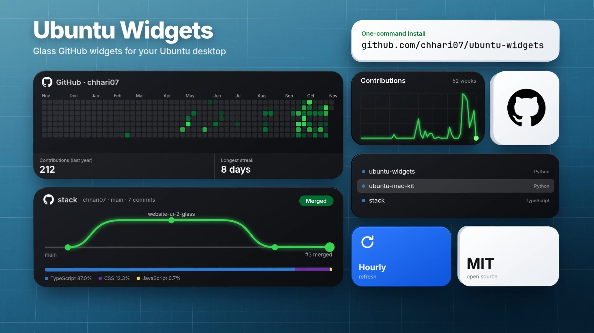
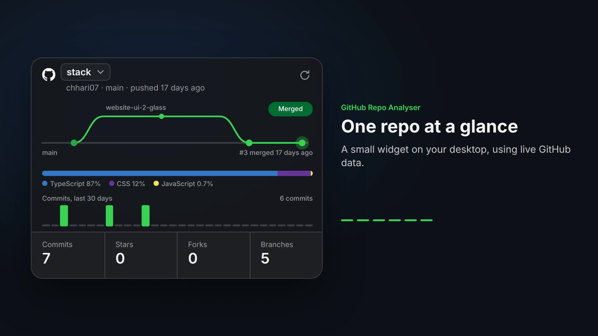
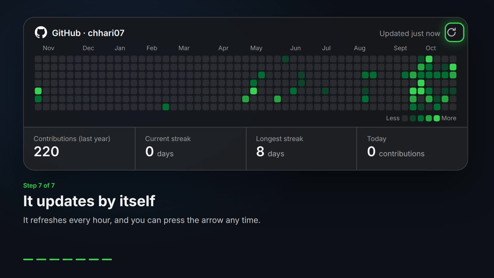

# Ubuntu Widgets

Glass GitHub widgets for the Ubuntu desktop, installed with one command.
The same two widgets also run on my Android home screen ([GitHub Widgets](https://amankumarchhari.vercel.app/tools/github-phone-widgets)). More of my tools: [amankumarchhari.vercel.app/ui-kit](https://amankumarchhari.vercel.app/ui-kit).

[](LICENSE)

[](https://github.com/chhari07/ubuntu-widgets/actions/workflows/ci.yml)

```bash
curl -fsSL https://github.com/chhari07/ubuntu-widgets/releases/latest/download/install.sh | bash
```

[](docs/media/ubuntu-widgets-brand-16x9.mp4)

**[Watch the video](docs/media/ubuntu-widgets-brand-16x9.mp4)** (14 seconds, with sound) · [Vertical version](docs/media/ubuntu-widgets-brand-9x16.mp4)

| GitHub Repo Analyser | GitHub Contribution Calendar |
| --- | --- |
|  |  |

## Contents

- [The widgets](#the-widgets)
- [Requirements](#requirements)
- [Installation](#installation)
- [Options](#options)
- [Using the widgets](#using-the-widgets)
- [Uninstalling](#uninstalling)
- [Privacy](#privacy)
- [How it works](#how-it-works)
- [Repository layout](#repository-layout)
- [Development](#development)
- [Troubleshooting](#troubleshooting)
- [License](#license)

## The widgets

| Widget | What it shows | Data source | Refreshes |
| --- | --- | --- | --- |
| GitHub Repo Analyser | Pick any repo you own to see its latest merged pull request replayed as a green line, its languages, 30 days of commits, and commit, star, fork and branch counts | Your `gh` login | Every 30 minutes |
| GitHub Contribution Calendar | Your last year of contributions, total, current and longest streak, and today's count | Your public GitHub profile page, no login needed | Every hour |

Both also refresh after the laptop wakes and when you press the refresh arrow.

## Requirements

- Ubuntu 24.04 with GNOME, on Wayland or X11. This is the tested platform.
- `python3-gi` and `gir1.2-gtk-3.0`, included with Ubuntu Desktop. Without `librsvg2-common`, also included, the calendar runs without its logo.
- For the Repo Analyser: `gir1.2-webkit2-4.1` and a logged-in [GitHub CLI](https://cli.github.com/).

To add anything that is missing:

```bash
sudo apt install python3-gi gir1.2-gtk-3.0 gir1.2-webkit2-4.1 gh
gh auth login
```

The installer checks all of this and tells you what to run. It never uses `sudo` itself.

## Installation

Run the command at the top of this page. It verifies the download's checksum, installs into your home folder,
starts the widgets, and sets them to start at every login.

To read the script before running it:

```bash
curl -fsSL -o install.sh https://github.com/chhari07/ubuntu-widgets/releases/latest/download/install.sh
less install.sh
bash install.sh
```

You can also install from a clone:

```bash
git clone https://github.com/chhari07/ubuntu-widgets.git
cd ubuntu-widgets
./install.sh
```

To update, run the install command again. Your settings and widget positions are kept.

## Options

Add options after `bash -s --` when piping:

```bash
curl -fsSL https://github.com/chhari07/ubuntu-widgets/releases/latest/download/install.sh | bash -s -- --github-user octocat
```

| Option | Effect |
| --- | --- |
| `--github-user NAME` | User shown by the calendar. Default: the saved name, then your `gh` login, then a prompt |
| `--only calendar` or `--only analyser` | Install one widget. Default: both |
| `--no-start` | Install without starting the widgets now |
| `--version` | Print the installer version |
| `--help` | Show all options |

To show someone else's calendar later, run the installer again with `--github-user`.

## Using the widgets

- **Move:** drag the card. Its position is remembered.
- **Menu:** right-click for refresh, open on GitHub, and hide.
- **Bring back a hidden widget:** open it from the app launcher.
- **Control from a terminal:**

```bash
python3 ~/.local/share/ubuntu-widgets/repo-analyser/widget.py --toggle
python3 ~/.local/share/ubuntu-widgets/contribution-calendar/widget.py --refresh
```

Commands: `--show`, `--hide`, `--toggle`, `--refresh`.

## Uninstalling

```bash
~/.local/share/ubuntu-widgets/uninstall.sh
```

This removes the widgets, launcher and autostart entries, settings and saved data. It does not change `gh` or its login.

## Privacy

- The widgets run on your computer and have no server, analytics or telemetry. They talk only to GitHub.
- The calendar reads a public page and uses no token.
- The Repo Analyser runs `gh`, which uses your own login. **The dropdown includes your private repos**, marked
  `private`, so hide the widget before sharing your screen if their names are sensitive.
- The widgets never read or store your token. Saved data stays in `~/.cache/ubuntu-widgets`, and the Repo Analyser's
  files can be read only by your user.

## How it works

The calendar is built from GTK 3 widgets. The Repo Analyser is a GTK 3 window that shows a local HTML page in WebKit
and blocks navigation away from it, with a content security policy that allows no network access from the page.
Each widget is a single background app, so running a command talks to the copy already running. On Wayland they run
through XWayland, because Wayland apps cannot place their own windows.

| What | Where |
| --- | --- |
| Program files | `~/.local/share/ubuntu-widgets` |
| App launcher entries | `~/.local/share/applications/io.github.chhari07.UbuntuWidgets.*.desktop` |
| Login start entries | `~/.config/autostart/io.github.chhari07.UbuntuWidgets.*.desktop` |
| User name, position, chosen repo | `~/.config/ubuntu-widgets` |
| Saved GitHub data | `~/.cache/ubuntu-widgets` |

## Repository layout

```text
install.sh                   Installer, also the file published with each release
uninstall.sh                 Uninstaller
widgets/
  contribution-calendar/     Calendar widget
  repo-analyser/             Repo Analyser widget and its page
tests/                       Install tests and a run-on-a-display smoke test
tools/build-release.sh       Builds the release files
docs/media/                  Walkthrough videos and images
```

## Development

```bash
tests/test-install.sh                      # installs into a throwaway home folder
xvfb-run -a dbus-run-session -- tests/smoke.sh   # runs both widgets with made-up data
tools/build-release.sh                     # builds dist/ from the committed tree
```

CI runs ShellCheck, both tests and a Python syntax check on Ubuntu 24.04.

## Troubleshooting

| Problem | Fix |
| --- | --- |
| Repo Analyser says `Run: gh auth login` | Run that command in a terminal, then press the refresh arrow |
| Repo Analyser says `Offline` | Check your connection. Hover over the message to see the full error |
| Calendar says `Offline` | It retries every 5 minutes. Hover over the status for the error |
| Repo Analyser is missing after install | The installer skipped it because WebKitGTK is missing. Run `sudo apt install gir1.2-webkit2-4.1`, then install again |
| Widget does not appear | Run it from a terminal to see the error, for example `python3 ~/.local/share/ubuntu-widgets/repo-analyser/widget.py --show` |

## License

[MIT](LICENSE). The GitHub logo is a trademark of GitHub, Inc. This project is not affiliated with GitHub.
